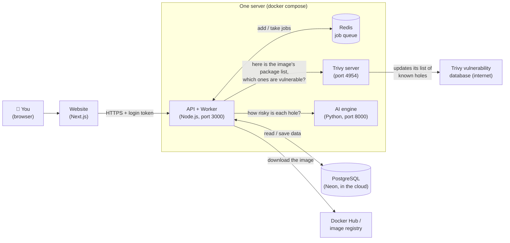
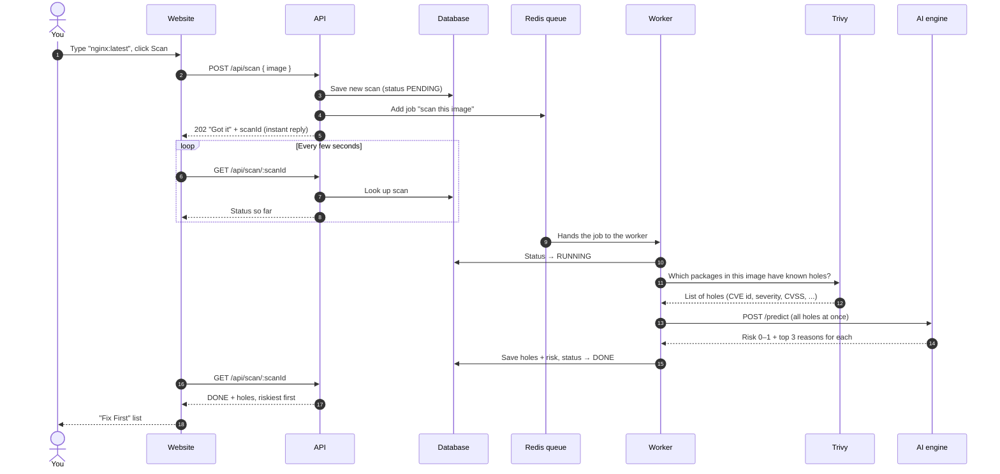
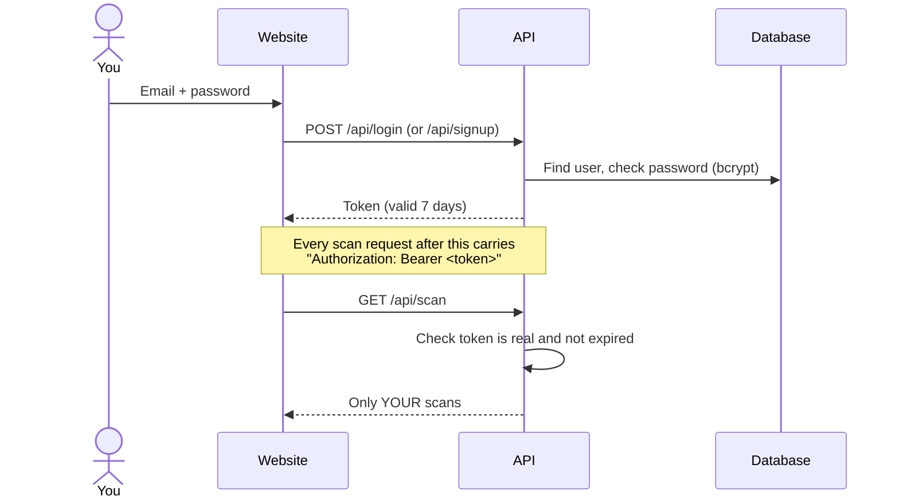
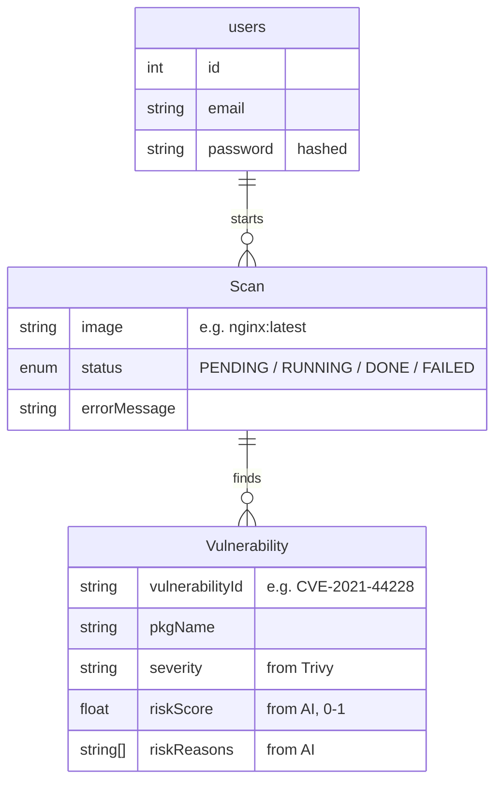
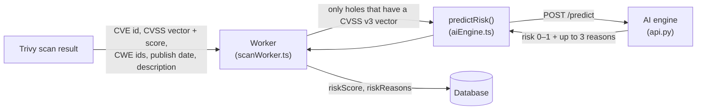

# How DockerGuard Works

DockerGuard checks a Docker image (a packaged app) for known security holes, then uses AI to say **which holes to fix first**.

This page explains the parts of the system and how they talk to each other, in plain words.

---

## The parts, as a restaurant

| Part | What it is | Restaurant version |
|---|---|---|
| **Website** (frontend) | The Next.js site you click around in. Lives in a separate repo and is hosted online (e.g. Vercel). | The customer at the table |
| **API** (`src/`) | The Node.js/Express server in this repo. The only part the website talks to. | The waiter: takes orders, brings food back |
| **Worker** (`src/workers/scanWorker.ts`) | Code that does the slow scanning work. Runs **inside the same program as the API**, just in the background. | The cook in the kitchen |
| **Redis** + BullMQ (`src/queues/scanQueue.ts`) | A to-do list of scans waiting to be done. | The order tickets pinned in the kitchen |
| **Trivy server** | A security tool that knows every publicly reported security hole (CVE). | The recipe book of "known bad ingredients" |
| **AI engine** (`ai-engine/`) | A small Python service with a trained model. Guesses how likely each hole is to be actually attacked, and says why. | The head chef who tastes and says "fix this one first" |
| **Database** (PostgreSQL on Neon) | Stores users, scans and the holes found. | The restaurant's notebook |

---

## The big picture



**Who can talk to whom:**

- The **website only talks to the API**. It never touches Redis, Trivy, the AI engine or the database directly.
- **Redis, Trivy and the AI engine are private.** Only the API is reachable from outside, and only through nginx over HTTPS (port 3000 itself is bound to the server's localhost). Inside the server they find each other by name (`redis`, `trivy`, `ai-engine`).
- The **database is outside the server**, hosted by Neon. Only the API connects to it.

---

## Step by step: what happens when you scan an image



In words:

1. **You ask for a scan.** The website sends the image name to the API.
2. **The API does not scan right away.** Scanning can take minutes, so the API writes a "scan" row in the database, puts a ticket on the Redis queue, and replies at once with a scan ID.
3. **The website keeps asking "done yet?"** using that scan ID.
4. **The worker picks up the ticket** from Redis and marks the scan as `RUNNING`.
5. **Trivy finds the holes.** The worker runs the Trivy tool, which downloads the image, lists every package inside it, and asks the Trivy server which of those have known holes.
6. **The AI engine ranks them.** The worker sends all holes in one request. For each one the AI returns a risk score (0 = unlikely to be attacked, 1 = very likely) and up to 3 reasons in plain English, like *"Can be attacked over the network"* or *"No login needed"*.
7. **Everything is saved** in one go and the scan becomes `DONE`.
8. **The website shows the results**, sorted so the riskiest holes come first.

---

## What happens when something goes wrong

| Problem | What DockerGuard does |
|---|---|
| Trivy fails or the image doesn't exist | The job is retried up to **3 times** (waiting 5s, 10s, 20s). If it still fails, the scan becomes `FAILED` with the error message. |
| The AI engine is down or slow (over 60s) | The scan **still finishes**. The holes are saved without a risk score and shown at the bottom of the list. |
| A hole has no CVSS v3 data | It is not sent to the AI (the model was never trained on such holes). It is saved without a risk score. |
| Many people scan at once | Jobs wait their turn in Redis. Only `SCAN_CONCURRENCY` scans run at the same time (1 on the small server) so the machine doesn't run out of memory. |

---

## Logging in



- Passwords are never stored as plain text, only as a scrambled hash.
- The token is like a wristband at an event: the API checks it on every scan request, and you can only see scans that belong to you.

---

## What is stored



**Severity vs. risk score:** *severity* (from Trivy) says how bad a hole *could* be. *Risk score* (from the AI) says how likely it is that attackers will *actually* use it. The list is sorted by risk score.

---

## API endpoints (what the website can call)

| Method | Path | Login needed | What it does |
|---|---|---|---|
| POST | `/api/signup` | No | Create an account, get a token |
| POST | `/api/login` | No | Log in, get a token |
| POST | `/api/scan` | Yes | Start a scan, get a `scanId` |
| GET | `/api/scan` | Yes | Your last 50 scans |
| GET | `/api/scan/:scanId` | Yes | One scan with its holes, riskiest first |
| GET | `/health` | No | Is the API up and can it reach the database? |

---

## The AI engine: a second server on the same machine

The AI engine is **its own small server**, separate from the API, but it runs **on the same machine** (as the `ai-engine` container next to `api`). It is not a separate computer.

**Why it is separate:** the API is Node.js, but the model and its libraries (XGBoost, scikit-learn, SHAP) are Python. Node can't load a Python model, so the model runs in a small Python web server (FastAPI) and the API calls it over HTTP. Later AI features (attack-type classifier, chatbot, auto-fix) will be added to this same Python server as new endpoints.

### Its one endpoint: `POST /predict`

This endpoint is **internal**. The website never calls it, and it can't be reached from the internet. Only the API's worker calls it.

| | |
|---|---|
| Where it runs | [ai-engine/api.py](ai-engine/api.py), started with `uvicorn api:app --port 8000` |
| Who calls it | `predictRisk()` in [src/lib/aiEngine.ts](src/lib/aiEngine.ts), called by the worker in [src/workers/scanWorker.ts](src/workers/scanWorker.ts) right after Trivy finishes |
| How the API finds it | The `AI_ENGINE_URL` setting: `http://ai-engine:8000` inside docker compose, `http://localhost:8000` when running locally |
| What model it uses | `ai-engine/out/model.joblib`, trained once by [ai-engine/train.py](ai-engine/train.py) on about 3 lakh public CVEs (NVD) labelled with CISA's list of actually-attacked ones (KEV). Training is not done on the server. |

### Where its input comes from



1. **Trivy** reports each hole with its details. `pickCvss()` in [src/lib/trivy.ts](src/lib/trivy.ts) picks the CVSS data (NVD's if available, since the model was trained on NVD).
2. **The worker** saves those details on each vulnerability and passes them to `predictRisk()`.
3. **`predictRisk()`** sends only the holes that have a CVSS v3 vector, all in one request, and puts the answers back in the right order.
4. **The AI engine** turns each hole into model inputs ([ai-engine/features.py](ai-engine/features.py)), the model gives the risk, and SHAP picks the reasons.
5. **The worker** saves `riskScore` and `riskReasons` in the database. The website reads them through `GET /api/scan/:scanId`.

Request and response:

```json
// request: a list of holes
[{ "id": "CVE-2021-44228",
   "vector": "CVSS:3.1/AV:N/AC:L/PR:N/UI:N/S:C/C:H/I:H/A:H",
   "score": 10, "cwes": ["CWE-502"],
   "published": "2021-12-10T10:15:00Z",
   "description": "Apache Log4j2 ... remote code execution ..." }]

// response: one answer per hole, same order
[{ "id": "CVE-2021-44228", "risk": 0.87,
   "reasons": ["CVSS score of 10.0", "Description mentions \"remote\"", "Can leak sensitive data"] }]
```

To try it by hand, run the AI engine locally and open `http://localhost:8000/docs`.

---

## Running it

Everything except the database starts with one command (see [docker-compose.yml](docker-compose.yml)):

```
docker compose up -d --build
```

This starts 4 containers: `api`, `redis`, `trivy`, `ai-engine`. The database connection and secrets come from `.env` (see [.env.sample](.env.sample)).
